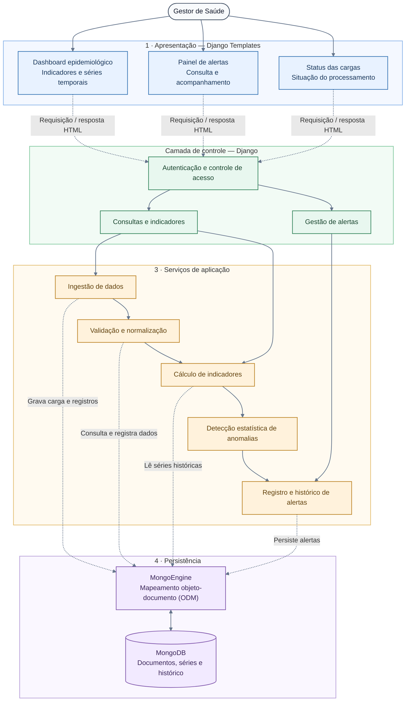

# 🛡️ VigiaSUS Local

<p align="center">


</p>
<p>
<strong>Sistema de apoio à vigilância epidemiológica
municipal</strong><br> Identificação precoce de
anomalias em agravos de notificação compulsória.
</p>

---

## 📋 Sobre o Projeto

O **VigiaSUS Local** é um sistema web desenvolvido para apoiar as
equipes municipais de saúde no monitoramento de indicadores
epidemiológicos e na identificação precoce de possíveis anomalias nas
notificações compulsórias.

A solução busca reduzir a dispersão e a falta de padronização dos dados
epidemiológicos, diminuindo a dependência de processos manuais de
extração, organização e cruzamento de planilhas.

Por meio da integração de dados agregados e da aplicação de métodos
estatísticos, o sistema identifica variações relevantes nas séries
temporais e apresenta alertas visuais que auxiliam os profissionais na
análise dos indicadores e na tomada de decisões.

### 🎯 Objetivos

-   Automatizar o processamento de dados epidemiológicos agregados.
-   Padronizar a análise de indicadores de saúde.
-   Identificar possíveis anomalias por meio de métodos estatísticos.
-   Apresentar alertas visuais para apoiar a vigilância epidemiológica.
-   Disponibilizar informações em um painel de acompanhamento.
-   Manter histórico dos alertas para facilitar a análise e a auditoria.

> **Importante:** os alertas estatísticos indicam possíveis anomalias e
> não constituem, isoladamente, confirmação de surtos ou diagnósticos
> epidemiológicos.

---

## ⚙️ Stack Tecnológica

  | Tecnologia    | Aplicação                                   |
  |---------------|---------------------------------------------|
  | Python 3.14+  | Linguagem de programação                    |
  | Django 6.1    | Framework web e lógica de aplicação         |
  | MongoDB       | Banco de dados NoSQL orientado a documentos |
  | MongoEngine   | ODM para integração com o MongoDB           |
  | Pytest        | Testes automatizados                        |
  | Pytest-Django | Integração dos testes com o Django          |
  | Git           | Controle de versão                          |
  | GitHub        | Hospedagem do código e colaboração          |

---
### 🧱 Organização arquitetural

O projeto utiliza uma arquitetura **monolítica modular baseada no padrão
MVT do Django**. Os módulos são organizados por responsabilidade,
separando as funcionalidades de ingestão, detecção estatística, gestão
de alertas e visualização dos indicadores.

O MongoDB é utilizado como camada de persistência, com o MongoEngine
como ferramenta de mapeamento entre os documentos e a aplicação Python.

---

## 🏛️ Arquitetura do Sistema

### 1. Visão geral

### 2. Módulos funcionais

---

  | Módulo         | Responsabilidade                                                    |
  |----------------|---------------------------------------------------------------------|
  | `ingestao`     | Recepção, validação e processamento inicial dos dados               |
  | `deteccao`     | Cálculo dos indicadores estatísticos e identificação de anomalias   |
  | `alertas`      | Registro, acompanhamento e histórico dos alertas                    |
  | `dashboard`    | Apresentação das séries temporais e dos indicadores epidemiológicos |
  | `Autenticação` | Controle de acesso aos recursos protegidos da aplicação             |

---

### 3. Fluxo de processamento dos dados

1.  **Ingestão de dados:** o módulo `ingestao` recebe arquivos
    estruturados ou dados de fontes integradas, valida os registros e
    identifica inconsistências.
2.  **Processamento estatístico:** o módulo `deteccao` analisa as séries
    temporais utilizando uma janela histórica de oito semanas e calcula
    os parâmetros estatísticos definidos para o projeto.
3.  **Identificação de anomalias:** os valores observados são comparados
    com o limiar superior calculado a partir da média e do desvio
    padrão.
4.  **Registro de alertas:** quando uma observação ultrapassa o limite
    estabelecido, o módulo `alertas` pode registrar uma ocorrência para
    análise posterior.
5.  **Visualização:** o `dashboard` apresenta os indicadores e as
    ocorrências identificadas para consulta pelos usuários autorizados.

---

## 📊 Método Estatístico

O sistema utiliza uma abordagem baseada na média e no desvio padrão para
sinalizar valores que apresentam comportamento atípico em relação à
série histórica.

O limite superior de referência é representado por:

$$
L = \mu + 2\sigma
$$

Em que:

-   (L): limite superior de referência.
-   (`\mu`{=tex}): média dos valores da janela histórica.
-   (`\sigma`{=tex}): desvio padrão dos valores analisados.

A janela de análise prevista para o projeto corresponde a **oito
semanas**.

Quando o valor observado ultrapassa o limite calculado, o sistema pode
gerar um alerta de possível anomalia. A classificação é estrita (`observado >
limite`): valores iguais ao limite não são anomalias. Para cada semana avaliada,
o cálculo utiliza as oito semanas imediatamente anteriores, exigindo nove
observações na série para classificar a primeira semana. As oito semanas do
histórico precisam ser consecutivas; janelas com semanas ausentes são ignoradas
até haver oito semanas consecutivas disponíveis. A média, o desvio padrão
populacional e a classificação são persistidos na coleção `resultados_deteccao`.
Após uma carga aceita, as séries de agravo/município afetadas são recalculadas
na mesma transação da ingestão; falhas na detecção impedem a carga de ser
marcada como aceita.

> A interpretação dos resultados deve considerar a qualidade dos dados,
> a sazonalidade, o contexto epidemiológico e a avaliação dos
> profissionais responsáveis. O limiar estatístico é um mecanismo de
> sinalização, não uma confirmação automática de surto.

---

## 🧪 Testes Automatizados

A estratégia de testes utiliza `pytest` e `pytest-django` para verificar
o comportamento dos componentes da aplicação.

Os testes podem contemplar:

-   Serviços estatísticos e cálculos de referência.
-   Regras de negócio para identificação de anomalias.
-   Validação e tratamento de dados de entrada.
-   Persistência e consulta de documentos no MongoDB.
-   Comportamento das views e integração dos módulos.

### Executando os testes

Com o ambiente virtual ativado e as dependências instaladas, execute:

``` bash
pytest
```

Para executar os testes com informações mais detalhadas:

``` bash
pytest -v
```

**Pré-requisitos:** Python compatível com a versão utilizada no projeto,
dependências instaladas, configurações de ambiente definidas e acesso ao
MongoDB quando exigido pelos testes.

### Executar a aplicação com Docker

Com Docker Engine e Docker Compose instalados, prepare as configurações locais
e inicie os containers da aplicação e do MongoDB:

```bash
cp .env.example .env
docker compose up --build
```

A aplicação ficará disponível em <http://localhost:8000/admin/>. O MongoDB
usa um volume nomeado (`mongodb_data`), então os dados permanecem entre
reinicializações. As migrações são executadas automaticamente quando o
container web inicia. Para interromper os serviços, use `Ctrl+C`; para
encerrá-los em segundo plano, use `docker compose down`.

Os testes também podem ser executados no container:

```bash
docker compose --profile test run --rm tests
```

Para remover também os dados persistidos no volume:

```bash
docker compose down -v
```

O `runserver` incluído no Compose é voltado ao desenvolvimento local, não à
publicação em produção. Os valores em `.env.example` são apenas para
execução local; configure segredos próprios antes de expor a aplicação.

---

## 🚀 CI/CD com GitHub Actions

O workflow [`.github/workflows/ci-cd.yml`](.github/workflows/ci-cd.yml) executa
lint com Ruff, `manage.py check` e testes com `pytest` para cada push e pull
request direcionado à branch `main`. O MongoDB 7 é iniciado como serviço de
banco para os testes. O pipeline usa Python 3.14, conforme a stack do projeto.

Ao criar e enviar uma tag no formato `v*` (por exemplo, `v1.0.0`), o pipeline
aguarda a CI e publica automaticamente um GitHub Release com um arquivo `.tar.gz`
do código-fonte e notas de versão geradas pelo GitHub. Assim, você pode
versionar e disponibilizar releases sem precisar de um servidor próprio.

Para publicar uma versão, use:

```bash
git tag v1.0.0
git push origin v1.0.0
```

O repositório precisa permitir que o `GITHUB_TOKEN` crie releases nas
configurações de Actions. Isso faz a entrega/publicação do código; hospedar e
executar a aplicação em produção pode ser configurado separadamente no futuro.

---

## 👥 Autores e Equipe de Desenvolvimento

O **VigiaSUS Local** foi desenvolvido como projeto acadêmico da
disciplina de **Engenharia de Software da Universidade Federal de
Sergipe (UFS)**.


<table>
<tr>
<td align="center" width="200">
<a href="https://github.com/EvandroJneto">

<br> <strong>EvandroJneto</strong>
</a> <br> <sub>Desenvolvedor</sub>
<br> <a href="https://github.com/EvandroJneto">Ver perfil ↗</a>
</td>
<td align="center" width="200">
<a href="https://github.com/HugooPaixao">

<br> <strong>HugooPaixao</strong>
</a> <br> <sub>Desenvolvedor</sub>
<br> <a href="https://github.com/HugooPaixao">Ver perfil ↗</a>
</td>
<td align="center" width="200">

<a href="https://github.com/sibeleoliveirac">

<br><strong>sibeleoliveirac</strong>
</a> <br><sub>Desenvolvedora</sub>
<br><a href="https://github.com/sibeleoliveirac">Ver
perfil ↗</a>
</td>
<td align="center" width="200">
<a href="https://github.com/S1l45S">

<br><strong>S1l45S</strong> </a>
<br><sub>Desenvolvedor</sub>
<br><a href="https://github.com/S1l45S">Ver perfil
↗</a>
</td>
<td align="center" width="200">
<a href="https://github.com/ysrael12">

<br><strong>ysrael12</strong> </a>
<br><sub>Desenvolvedor</sub>
<br><a href="https://github.com/ysrael12">Ver perfil
↗</a>
</td>
</tr>
</table>


---

## 📄 Licença
Este projeto é distribuído sob os termos da GNU Affero General Public
License v3.0 (AGPL-3.0). Consulte o arquivo [`LICENSE.txt`](LICENSE.txt)
na raiz do repositório para acessar o texto integral da licença.

Em linhas gerais, a AGPL-3.0 é uma licença de software livre com copyleft.
Ela estabelece condições para copiar, modificar e redistribuir o software
e inclui obrigações específicas quando versões modificadas são utilizadas
para oferecer interação com usuários por meio de uma rede. Antes de
redistribuir ou disponibilizar uma versão modificada, consulte o texto
integral da licença para verificar as obrigações aplicáveis.

Este projeto foi desenvolvido no contexto acadêmico da disciplina de
Engenharia de Software da Universidade Federal de Sergipe (UFS).

---

<p align="center">
🛡️ <strong>VigiaSUS Local</strong><br>
<sub>Tecnologia e análise de dados a serviço da vigilância
epidemiológica municipal.</sub>
</p>

